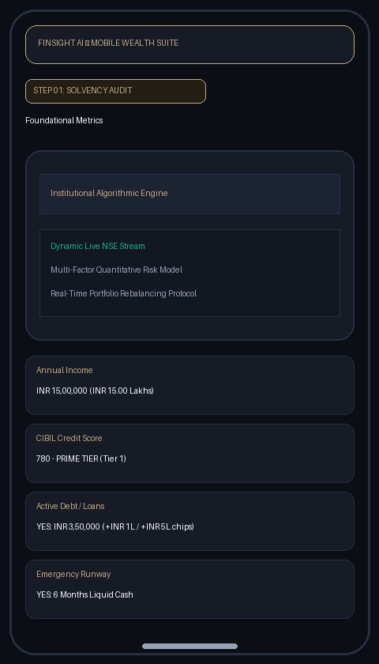
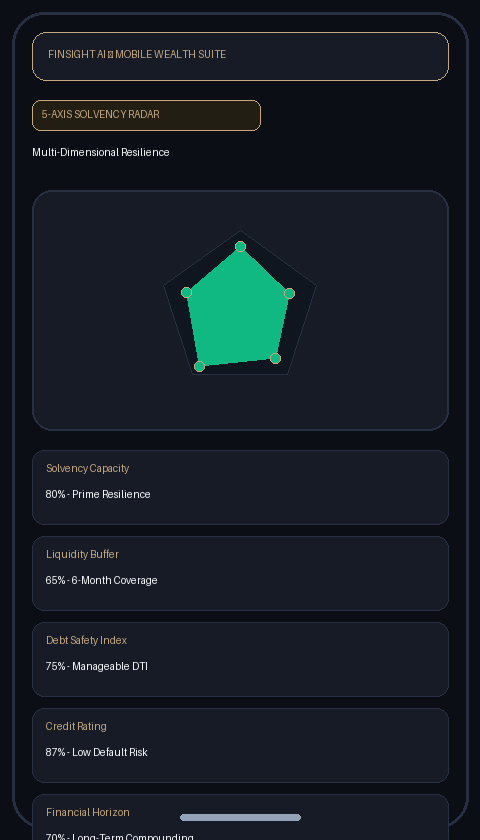
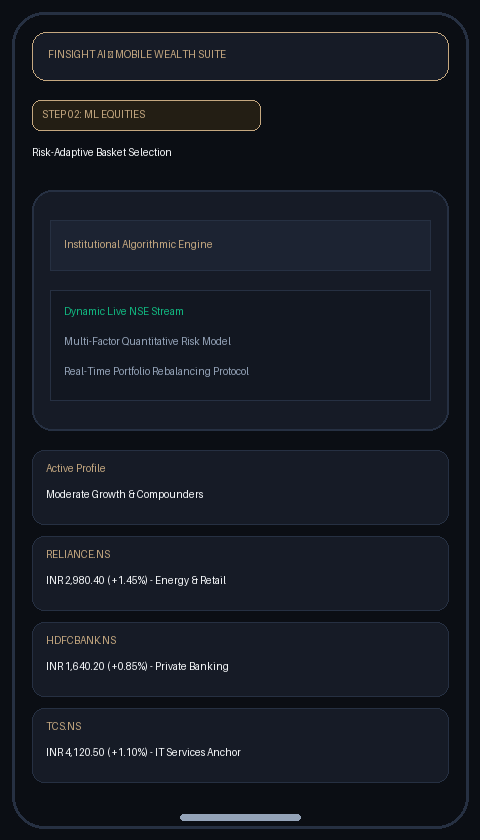
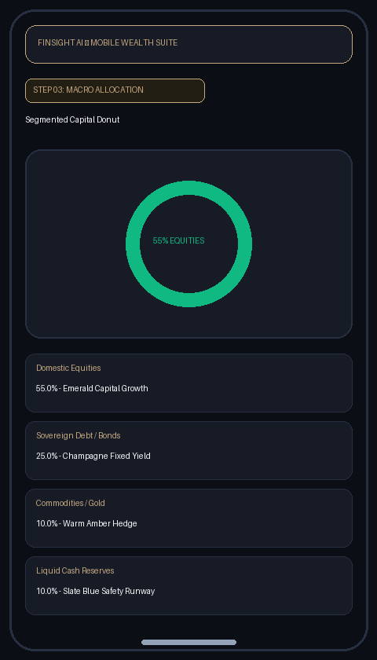
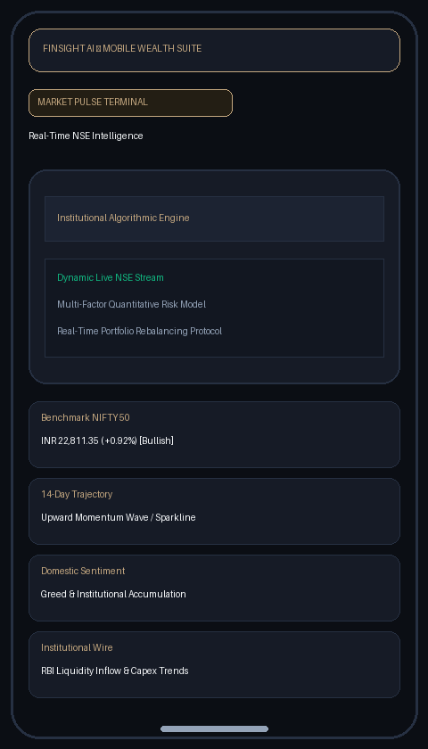
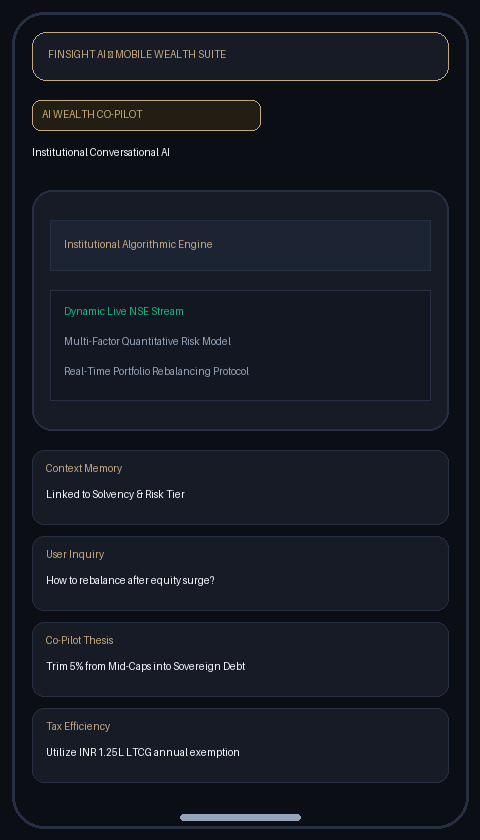

# FinSight AI — Institutional Wealth Management Platform

> **FinSight AI** is an autonomous, quantitative wealth advisory ecosystem tailored for Indian retail and accredited investors. Built with a clean-slate mobile architecture and backed by an asynchronous FastAPI core, FinSight unifies institutional solvency auditing, machine learning risk classification, and real-time National Stock Exchange (NSE) market intelligence.

---

## 📱 Mobile Visual Showcase

| Step 01: Solvency Audit | 5-Axis Polygon Radar | Step 02: Equities Basket |
| :---: | :---: | :---: |
|  |  |  |

| Step 03: Macro Allocation | Market Pulse Live Feed | AI Financial Co-Pilot |
| :---: | :---: | :---: |
|  |  |  |

---

## 🛡️ Step 01: Foundational Solvency & Balance Sheet Audit

The application enforces a **clean-slate initialization**—no synthetic mock data or pre-assumed financial standing. Users input authentic figures with instant Indian numbering word previews (`₹ Lakhs / Cr`):

- **Debt & Liability Capacity:** Evaluates fixed obligations, active loan EMIs, and debt-to-income (DTI) health with quick-increment pills (`+₹1 Lakh`, `+₹5 Lakh`, `+₹10 Lakh`).
- **Credit Standing:** Credit bureau scoring normalized with color-coded risk bands (Poor, Fair, Prime).
- **5-Axis Solvency Polygon Radar:** Dynamic SVG polygon plotting **Solvency (80%)**, **Liquidity (20%)**, **Debt Safety (50%)**, **Credit Score (47%)**, and **Horizon (49%)**.
- **Vulnerable Solvency Safety Intercept:** If personal metrics indicate financial vulnerability (`POOR` tier), an automated risk confirmation modal intercepts capital deployment into volatile equities until emergency cash runways are established.

---

## 📈 Step 02: Risk-Adaptive Quantitative Equity Engine

Rather than offering generic stock screens, FinSight AI leverages a trained **Scikit-Learn Random Forest Classifier** to map multidimensional solvency indices to personalized risk profiles:

- **Conservative:** High-solvency capital preservation focusing on blue-chip dividend compounders (`HDFCBANK.NS`, `ITC.NS`, `TCS.NS`, `RELIANCE.NS`), sovereign debt, and lower volatility anchors.
- **Moderate:** Balanced growth targeting defensive large-caps combined with resilient mid-cap compounders (`INFY.NS`, `ICICIBANK.NS`, `BHARTIARTL.NS`, `LT.NS`).
- **Aggressive:** Alpha generation strategies featuring momentum-driven high-beta equities (`BAJFINANCE.NS`, `TATAMOTORS.NS`, `TITAN.NS`, `LTIM.NS`) with strict stop triggers.
- **Interactive Groww Charts:** In-app interactive price sheets with instant external browser fallbacks (`Open on Groww ↗`).

---

## ⚖️ Step 03: Macro Capital Architecture & Rebalancing Policy

Step 3 establishes the portfolio's top-level capital framework:

- **Segmented SVG Donut Ring:** Multi-colored asset distribution dividing total net worth across Domestic Equities (Emerald `#10B981`), Sovereign Debt/Bonds (Champagne Gold `#C5A880`), Commodities/Gold (Warm Amber `#F59E0B`), and Liquid Cash Reserves (Slate Blue `#64748B`).
- **Institutional Rebalancing Rules:** Automated threshold parameters triggering rebalancing notifications whenever an asset class deviates by more than **±5.0%** from target weight.
- **Drift Tolerance Policies:** Preserves capital during market volatility by preventing premature churning while systematically locking in equity profits.

---

## ⚡ Market Pulse & Real-Time Intelligence

A dedicated real-time terminal built directly into the mobile experience:

- **Live Benchmark Tracking:** Continuous NIFTY 50 price quotes, daily delta points, and percentage movements.
- **14-Day Trajectory Sparklines:** Dynamic SVG wave trendline visualization capturing momentum, support levels, and consolidation patterns.
- **Domestic Sentiment Index:** Automated aggregation of market breadth indicators classifying market bias as Bullish, Neutral, or Risk-Off.
- **Integrated News Feed:** Institutional wire summaries with modal reader support and external publisher fallback links (`Read Source ↗`).

---

## 🤖 Context-Aware AI Financial Co-Pilot

FinSight AI includes an embedded conversational assistant:

- **Balance Sheet Memory:** Directly reads personal solvency outcomes to tailor recommendations without re-prompting.
- **Quantitative Inquiry:** Real-time analysis of valuation multiples (P/E, P/B, EV/EBITDA), tax provisions (LTCG / STCG under Indian tax laws), and asset allocation trade-offs.
- **Non-Custodial Guidance:** Advisory strictly focused on capital allocation discipline, liquidity safeguards, and risk management without unauthorized execution.
