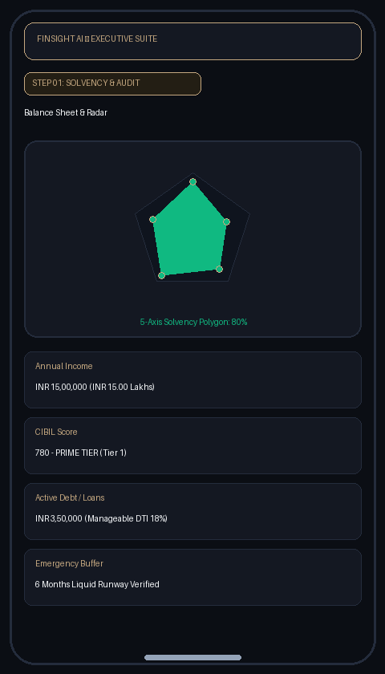
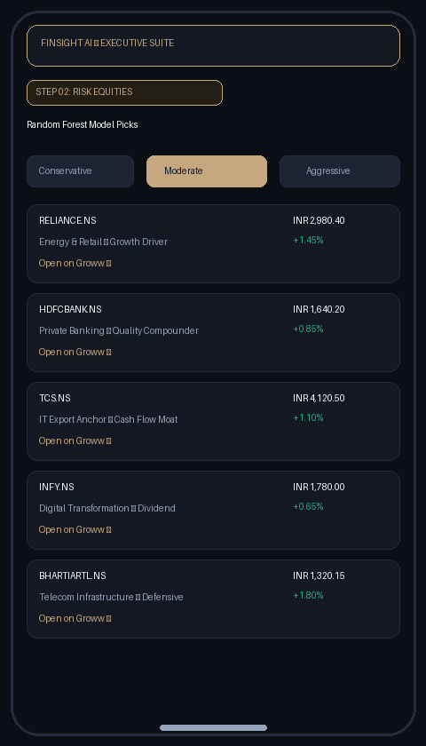
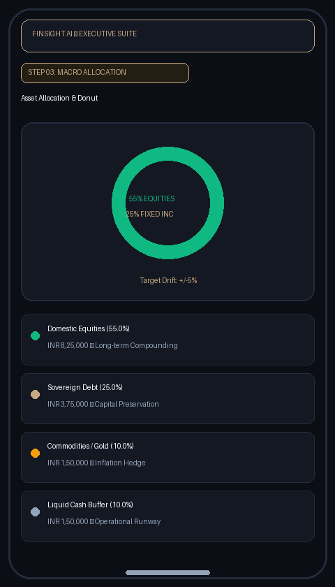
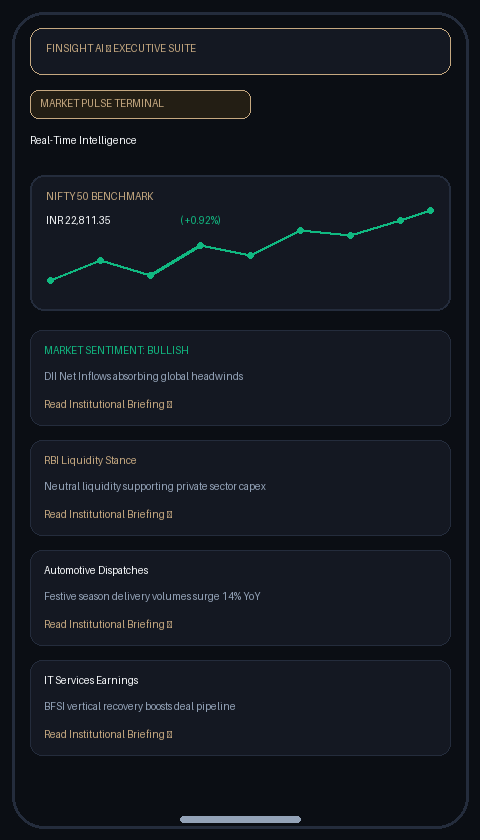

# FinSight AI

[](https://github.com/Aditthan-07/Investor_App/releases/latest)
[](https://expo.dev/)
[](https://reactnative.dev/)
[](https://fastapi.tiangolo.com/)
[](https://python.org)
[](https://www.typescriptlang.org/)

An institutional-grade wealth management and solvency intelligence platform built for Indian capital markets. Combines dynamic solvency audits, machine-learning risk profiling, and real-time market data into a clean, mobile-first interface.


---

## Preview

<div align="center">

| Step 1: Solvency Audit | Step 2: Equities Basket | Step 3: Allocation | Market Pulse |
| :---: | :---: | :---: | :---: |
|  |  |  |  |

</div>


---

## Core Features

- **Personal Solvency Audit:** Real-time 5-axis solvency radar evaluating debt-to-income, credit health, and liquid emergency reserves.
- **ML Risk-Adaptive Equities:** Scikit-Learn Random Forest model that maps personal financial capacity to tailored equity baskets with interactive charting.
- **Macro Asset Allocation:** Segmented portfolio donut visualizer covering Equities, Debt, Gold, and Cash with target rebalancing rules.
- **Market Pulse:** Live NIFTY 50 benchmark tracking, 14-day price sparklines, and institutional market news summaries.
- **AI Financial Co-Pilot:** Context-aware assistant providing answers on valuation ratios, tax rules, and allocation strategies.


---

## Project Structure

```text
├── apps/
│   ├── mobile/          # Expo SDK 51 / React Native client
│   └── web/             # Next.js desktop portal
├── backend/
│   ├── app/
│   │   ├── api/v1/      # REST API endpoints (health, recommend, market, chat)
│   │   ├── services/    # Solvency radar, ML model, and yfinance cache
│   │   └── schemas/     # Pydantic validation contracts
│   └── main.py          # FastAPI server entry point
├── docs/assets/         # Application screenshots and diagrams
└── backend/             # Quantitative microservices & ML models
```


---

## Backend Setup

```bash
cd backend

# Create & activate virtual environment
python -m venv venv
# Windows: .\venv\Scripts\activate | macOS/Linux: source venv/bin/activate

# Install dependencies and start server
pip install -r requirements.txt
uvicorn app.main:app --host 127.0.0.1 --port 8000 --reload
```

- API Docs: [http://127.0.0.1:8000/docs](http://127.0.0.1:8000/docs)
- Health Probe: [http://127.0.0.1:8000/healthz](http://127.0.0.1:8000/healthz)


---

## Mobile Setup

```bash
cd apps/mobile

# Install packages
npm install

# Option A: In-Browser Simulator
npx expo start --web --port 8081

# Option B: Physical Device (Expo Go)
npx expo start --tunnel
```

- Web Simulator: [http://localhost:8081](http://localhost:8081)
- Expo Go: Scan the terminal QR code from iOS or Android


---

## Core API Endpoints

| Method | Endpoint | Description |
| :---: | :--- | :--- |
| `GET` | `/healthz` | Microservice liveness & readiness probe |
| `POST` | `/api/v1/health` | Audits personal solvency metrics & returns 5-axis polygon scores |
| `POST` | `/api/v1/recommend/` | Predicts ML risk tier & delivers tailored equity basket allocations |
| `GET` | `/api/v1/market/nifty` | Real-time NIFTY 50 quote, intraday delta, and 14-day sparkline wave |
| `POST` | `/api/v1/chat` | Context-aware AI Co-Pilot financial conversation engine |


---

## Configuration & Tech Stack

### Environment (`.env.example`)
```env
PORT=8000
ENVIRONMENT=production
CORS_ORIGINS=["http://localhost:8081","http://localhost:3000"]
CACHE_TTL_SECONDS=300
```

### Technology Summary

| Layer | Technologies |
| :--- | :--- |
| **Mobile Client** | Expo SDK 51, React Native 0.74, TypeScript, Lucide Icons |
| **Backend Core** | FastAPI, Python 3.11+, Uvicorn, Pydantic v2 |
| **Machine Learning** | Scikit-Learn (Random Forest), NumPy, Pandas |
| **Market Data** | Yahoo Finance (`yfinance`) with persistent fallback cache |


---

## 📲 App Download & Installation

1. Download the latest `FinSight-AI.apk` from the [GitHub Releases](https://github.com/Aditthan-07/Investor_App/releases/latest) section.
2. Transfer or open the `.apk` on any Android device running Android 9.0 (API 28) or higher.
3. If prompted, allow installation from your browser or file manager ("Install unknown apps").
4. Launch **FinSight AI** and begin your clean-slate solvency audit.


---

## License & Attribution

- **Repository:** [Aditthan-07/Investor_App](https://github.com/Aditthan-07/Investor_App)
- **License:** Open-source under the [MIT License](LICENSE).

> **Disclaimer:** FinSight AI is an algorithmic decision-support tool created for educational and quantitative research purposes. It does not provide SEBI-registered investment advice. All financial market trading entails risk of capital loss.
